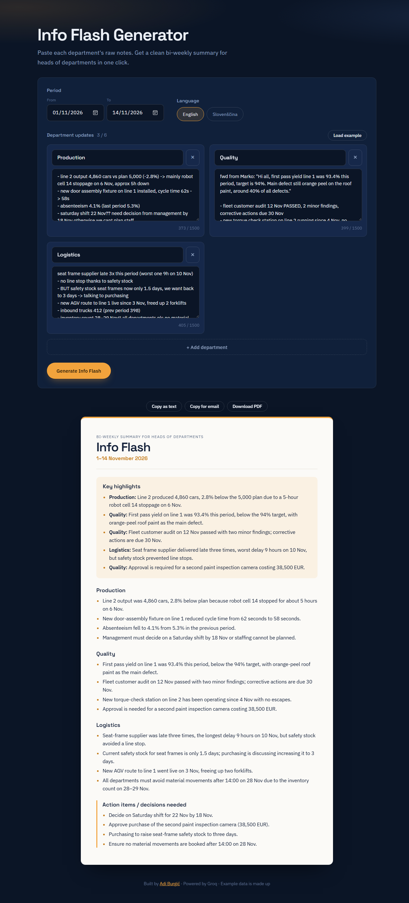

# Info Flash Generator

Turn messy notes from several departments into a clean bi-weekly **Info Flash** for heads of departments in one click.

<!-- Add a screenshot: save it as docs/screenshot.png -->


**Live demo:** https://info-flash-generator.vercel.app/

---

## The problem

At Revoz I created the template for the **Info Flash**, a bi-weekly summary for heads of departments. Each issue gives the key highlights, a short update from every department and the decisions that are needed.

Putting each issue together was manual work. Every department sends its notes in its own format: bullet points, half-sentences, forwarded emails. Someone then has to read them all, pick out what matters, rewrite it in one consistent style and format it.

So I built a tool that writes the first draft in one click. You paste each department's raw notes, choose the period and the language, and you get a structured report that is ready to check, copy into an email or save as a PDF.

## How it works

```
Browser  ──POST /api/generate──▶  Vercel serverless function  ──▶  Groq API
(form + report)                    (adds the secret API key,          (LLM, JSON mode)
                                    checks input and output)
         ◀──── clean report JSON ────────────┘
```

1. In the browser you add 1 to 6 departments, each with a name and its raw notes, then pick the period (two dates) and English or Slovenian.
2. The browser sends this to **one serverless function**, `/api/generate`.
3. The function checks the input again (the server never trusts the browser), reads the Groq API key from the `GROQ_API_KEY` environment variable and sends **one** request to Groq in **JSON mode**.
4. The AI returns highlights, one section per department and any action items. The function checks this answer and sends a clean report object back to the browser.
5. The browser builds the report with `textContent` only, so the AI's text can never be run as HTML.

**The API key is never exposed.** It only exists on the server, as an environment variable. The browser never sees it, and it is not in the code or in git.

## Features

- **1 to 6 departments**, each with a name and a notes field (max 1,500 characters, with a live counter)
- **Period** chosen with two date pickers (no typos), formatted by the server in the report language: `1–14 October 2026` / `1.–14. oktober 2026`
- **English / Slovenian** output, even when the notes are written in another language
- **One request in JSON mode** returns the whole report:
  - Title "Info Flash" + period
  - **Key highlights**: 3 to 5 one-line bullets across all departments, each labelled with its department
  - **One section per department**: 2 to 4 clear bullets
  - **Action items / decisions needed**: only shown if the notes contain any
- **AI rules**: keep all facts, numbers, names and dates exactly as given, never invent information or pad with filler, professional and concise tone
- **Consistent output**: one fixed writing style for every bullet (one sentence, ending with a period); headings, department names and the period come from the user, not the AI
- **Copy as text**: plain text with bullets
- **Copy for email**: formatted HTML with inline styles that pastes cleanly into Outlook
- **Download PDF**: uses the browser's "Save as PDF", with a print stylesheet that hides everything except the report
- **Load example**: fills in made-up notes for 3 departments of a fictional car factory
- **Error handling**: empty fields, notes that are too long, rate limit (429: "Too many requests, try again in a minute"), API errors, timeouts and network errors
- **Safe rendering**: AI output is shown with `textContent` only, never `innerHTML`

## Tech

- **Frontend**: plain HTML, CSS and JavaScript (no framework, no build step)
- **Backend**: one Vercel serverless function (`api/generate.js`, Node.js)
- **AI**: [Groq API](https://console.groq.com/), model `openai/gpt-oss-120b`, JSON mode
- **Design**: the same look as my [portfolio](https://adi-burgic.github.io): dark navy, orange accent, Space Grotesk + IBM Plex Sans

```
├── index.html        page structure
├── style.css         design + print stylesheet for the PDF
├── script.js         department cards, validation, rendering, copy/PDF
├── api/generate.js   the serverless function that calls Groq
├── dev-server.js     tiny server for running it locally (not used on Vercel)
└── .env.example      template for your API key
```

## Run locally

You need **Node.js 20.11 or newer** and a free Groq API key from [console.groq.com/keys](https://console.groq.com/keys).

```bash
# 1. Create your .env file from the template
cp .env.example .env

# 2. Open .env and paste your key:
#    GROQ_API_KEY=gsk_...

# 3. Start the local server (there are no dependencies to install)
npm run dev
```

Open <http://localhost:3000>, click **Load example**, then click **Generate Info Flash**.

`.env` is in `.gitignore`, so your key is never committed.

## Deploy to Vercel

1. Import the repository in Vercel.
2. Under **Settings → Environment Variables**, add `GROQ_API_KEY`.
3. Deploy. Vercel serves the static files and turns `api/generate.js` into the `/api/generate` endpoint automatically.

## Notes

- **Built with AI-assisted development** using [Claude Code](https://claude.com/claude-code).
- **Only made-up example data** was used to build and test this project. The example factory, its departments, numbers and names are fictional. No real company data is included.
